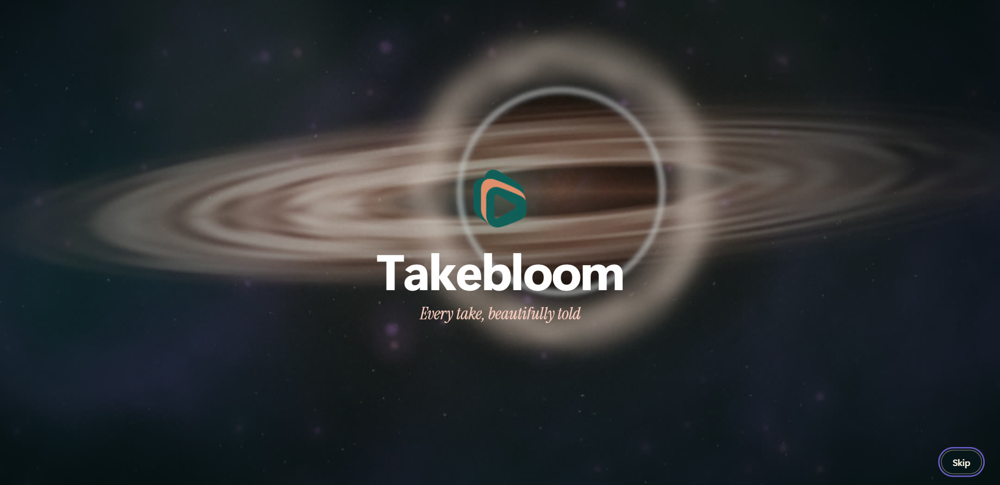
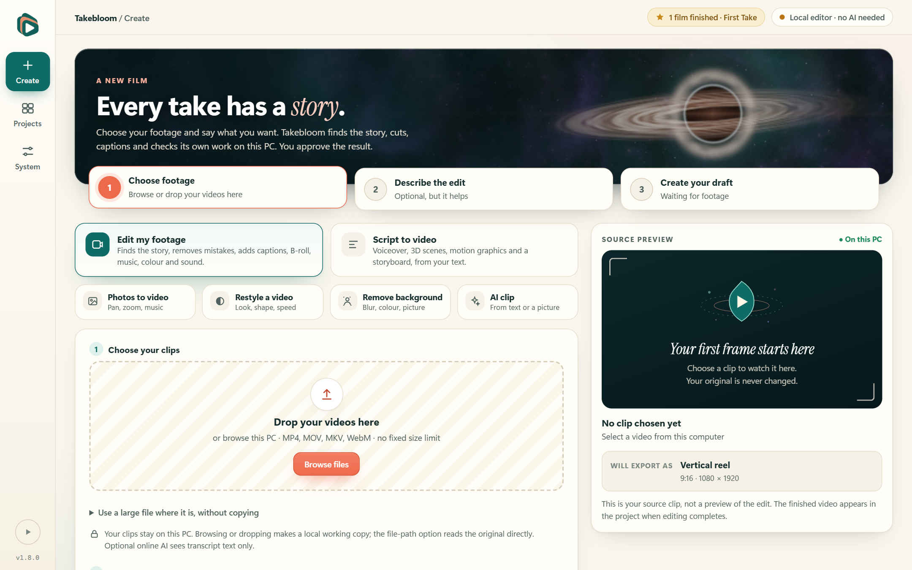
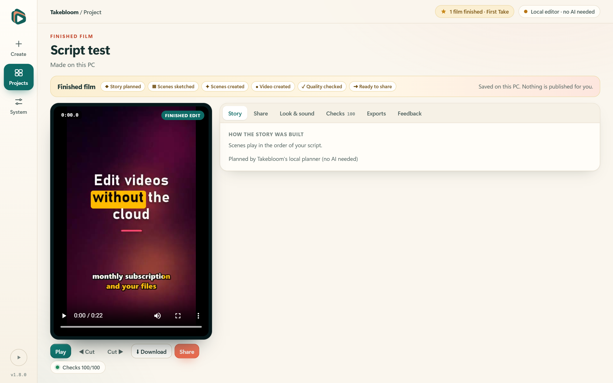
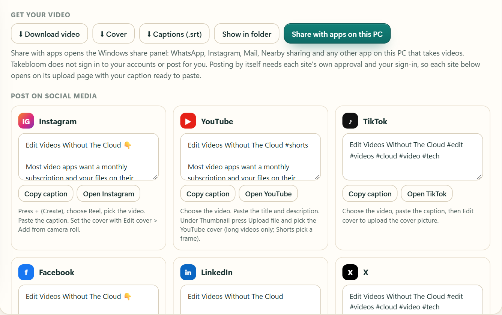
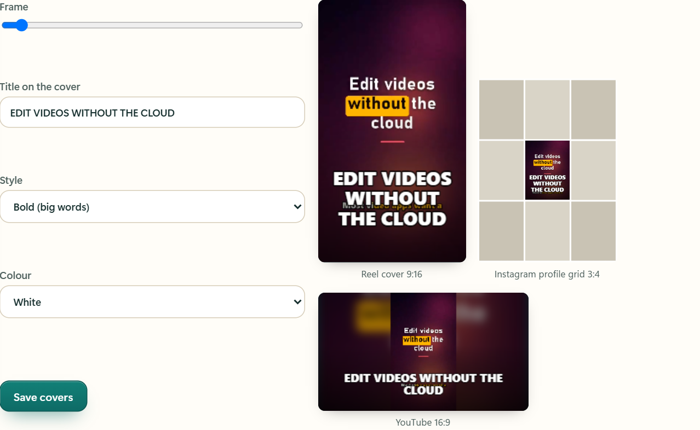
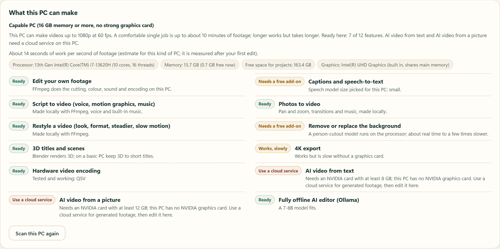
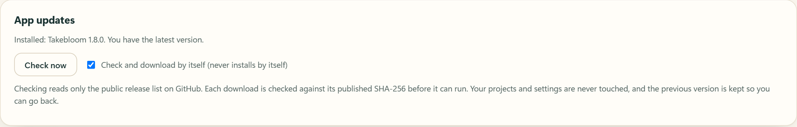
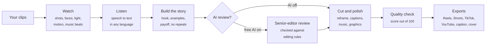

<div align="center">


# Takebloom

### Your raw clips in. A finished, captioned, ready-to-post video out.<br>On your own PC. Free. No account. No upload.

[](https://github.com/ganguydhrubo/video-studio/releases/latest/download/Takebloom-Setup.exe)
[](https://github.com/ganguydhrubo/video-studio/releases/latest)
[](LICENSE)


<br>



</div>

---

## Why Takebloom?

Most video apps hand you a timeline and wish you luck. **Takebloom does the edit for you.** It watches your footage, listens to every word, cuts the mistakes, builds a story with a hook and a payoff, adds captions, music and graphics, checks the result, and gives you a video for every platform, plus the caption and cover to post with it.

Everything runs on **your PC**. Your footage never leaves it unless you share it yourself.

<table>
<tr>
<td width="50%" valign="top">

### 🎬 Drop it in, it edits itself
Drop your clips, pictures and a song together. Takebloom starts by itself: it cuts silences, fillers and retakes, opens on your strongest line, ends on the payoff, and makes the covers. Want something special? Just say it: *"45-second Hinglish reel, black and white, no captions"*.

</td>
<td width="50%" valign="top">

### ✨ Motion graphics and 3D, from your words
*"3D title that spins"*, *"neon name tag with my name"*, *"confetti at the end"*. Real 3D letters, kinetic text, end cards and sparkles are placed where they never cover your big moments. All offline.

</td>
</tr>
<tr>
<td valign="top">

### 🖼️ Pictures, music and fixes
Add pictures to any edit, or make a film from pictures alone with one of 24 templates. After the edit, fix anything on a simple timeline: trim, reorder, re-caption, music level.

</td>
<td valign="top">

### ✂️ Cut-out, restyle and slow motion
Replace or blur the background without a green screen, with an optional Best quality mode for hair and clothes. Change the shape, the colour look, the speed and the stability of any clip.

</td>
</tr>
<tr>
<td valign="top">

### 📲 Share everywhere
Download in one click. Get ready captions for Instagram, YouTube, TikTok, Facebook, LinkedIn, X and WhatsApp. Make Instagram-style covers.

</td>
<td valign="top">

### 💻 Knows your PC
Before you start, it checks this computer and tells you honestly what it can make, how long it will take, and what needs a bigger machine.

</td>
</tr>
</table>

---

## See it work

<table>
<tr>
<td width="100%"></td>
</tr>
</table>

**Every finished film opens in a workspace**: player, story notes, every spoken line, look and sound, quality checks (scored out of 100), exports and your rating.



### Post it anywhere, with the caption already written



Each card has an editable caption with hashtags picked from what you actually said. **Open Instagram** copies the caption and opens the upload page. **Share with apps on this PC** opens the Windows share panel (WhatsApp, Mail, Nearby sharing and more).

### Covers that look right everywhere



Pick any frame, write a title, and see it as a **reel cover (9:16)**, inside an **Instagram profile grid (3:4)** and as a **YouTube thumbnail (16:9)** at the same time. One click saves all three.

### Honest about your hardware

<table>
<tr>
<td width="60%"></td>
<td width="40%" valign="top"><br><br>Safe in-app updates: the new version is checked before it replaces the old one, and the old one is kept so you can roll back.</td>
</tr>
</table>

---

## What happens inside an edit



<details>
<summary><b>Everything the editor does (click to open)</b></summary>

- **Works with no AI service at all.** A local editor brain (voice stress, key words, hook strength) and a video-sense pass (shots, sharpness, light, motion, people, music beats) decide the edit. A free AI editor reviews the story by default (transcript text only) and can be switched off with `--no-ai`.
- **Understands the footage first**: talking head, vlog, action, scenic/product or lifestyle.
- **Talking videos**: cuts mistakes, picks the hook, virtual camera angles, words behind you, a pop-out hook card.
- **No talking** (travel, product, cars, events): a beat-synced montage of the best moments, on your own music if the clip has it.
- **Builds a story**: cuts the self-intro, sign-off and repeats, opens cold on the strongest self-contained claim, keeps concrete examples (names, numbers) and ends on the payoff. Works in any spoken language: each line is translated to English on this PC to judge its meaning.
- **Paces it**: holds a beat after strong lines and questions, runs weak lines tight.
- **B-roll** from your own clips, matched to what each line means. Optional free stock clips from Pexels or Pixabay with your own free key (only a few search words leave your PC, and every clip is credited).
- **Smooth joins**: J-cuts and L-cuts at changes of clip, so the sound leads or trails the picture a little. Your voice stays exactly in sync.
- **Motion graphics and 3D** from your prompt: 3D titles, name tags, kinetic text, end cards, confetti and sparkles, rendered on your PC with HyperFrames and three.js.
- **Reframes** to 9:16, 16:9, 1:1 or 4:5 with face tracking and punch-in zooms.
- **Cleans** the voice and corrects the colour. It never replaces your background and never over-brightens a face.
- **Captions** with the spoken word highlighted, in native or Roman script, kept off your face and clear of the Reels/Shorts buttons.
- **Music**: your own tracks first, with the drop lined up to the hook; otherwise an original bed in one of six genres (lo-fi, trap, house, cinematic, desi tabla + tanpura, pop), different every video.
- **Your words**: `video-studio vocab add Sahkarmi Dhrubo` and names are always spelled right.
- **One long video to many shorts**, each with a plain-English reason.
- **Learns any style you show it**: give it reels you love; it measures their rhythm, beat sync, punch-ins and colour, and edits that way. Only numbers are kept.
- **Learns from every edit**: what you ask for, refine, keep, cut, download, share and rate. Next time, when your prompt says nothing about pace, captions, music or colour, it uses what you usually choose and tells you why, with real counts. What you write always wins. One button forgets it all. No AI model is trained, and nothing leaves your PC.
- **Every export** comes with a ready post, a cover and a Premiere/Resolve timeline.

</details>

---

## How it compares (honestly)

Takebloom is not trying to replace a professional timeline editor or a cloud video generator. It does a different job: **the whole edit, automatically, on your own PC, for free.**

| | **Takebloom** | Quick editors<br><sub>CapCut, VN, Filmora, Canva, Clipchamp, VEED, InVideo</sub> | Pro editors<br><sub>Premiere, Resolve, Final Cut, After Effects, HitFilm</sub> | Descript | AI generators<br><sub>Runway, Sora, Veo, Kling, Pika, Luma</sub> |
|---|:---:|:---:|:---:|:---:|:---:|
| Edits your footage for you, start to finish | ✅ | Partly (templates, auto-cut) | ❌ you edit by hand | Partly (edit by text) | ❌ makes new clips |
| Builds a story: hook, examples, payoff | ✅ | ❌ | ❌ | ❌ | ❌ |
| Works fully offline | ✅ | Mostly ❌ | ✅ | ❌ | ❌ |
| Your footage stays on your PC | ✅ | Mostly ❌ | ✅ | ❌ | ❌ |
| Free, no watermark, no account | ✅ | Partly | Resolve / HitFilm free, others paid | ❌ | ❌ credits |
| Tells you what your PC can make | ✅ | ❌ | ❌ | ❌ | n/a |
| Captions, post text and covers in one go | ✅ | Partly | ❌ | Partly | ❌ |
| Learns from every edit you make | ✅ | ❌ | ❌ | ❌ | ❌ |
| Manual timeline | Simple (trim, reorder, captions, pictures, music level) | ✅ | ✅✅ | ✅ | ❌ |
| Motion graphics and VFX depth | 3D titles, name tags, kinetic text, confetti (HyperFrames + three.js) | ✅ | ✅✅ (After Effects) | ❌ | n/a |
| Effects and template library size | 24 templates · 16 looks · 57 transitions | ✅✅ thousands | ✅✅ | Small | n/a |
| Generates new footage from text | ❌ by design: it edits the footage you shot | Partly | ❌ | ❌ | ✅✅ |
| Cut-out quality on hair and fast motion | Good; Best quality option (slow) | Very good | Very good | Good | n/a |

Takebloom uses **Blender** itself for 3D scenes, so that one is a partner, not a rival. If you need pixel-level manual control, finish in Resolve or Premiere: Takebloom exports an `.otio` timeline for exactly that.

---

## Install

1. **[Download Takebloom-Setup.exe](https://github.com/ganguydhrubo/video-studio/releases/latest/download/Takebloom-Setup.exe)** and run it. It installs for your user only and adds **Takebloom** to the Desktop and Start menu.
2. Open Takebloom and go to **System**. It scans your PC, explains what it can and cannot make, and sets up everything the editor needs in one click, even on a PC with no Python, FFmpeg or Node (about 1.3 GB, all free; each download shows its size and licence first and is checked before use; no admin rights needed):
   - **Set up by default:** FFmpeg, a private Python with speech-to-text, voice cleaning and face tracking, Node.js and HyperFrames for motion graphics and 3D titles.
   - **Optional:** Blender, the bigger speech model, the Best quality cut-out model, and an AI brain. The default is **OpenCode's free models** (no account). Ollama runs free and offline. Gemini and Qwen are free with an account. Claude and Codex need a paid plan. Takebloom never sees your password.

Every install shows the plan and the licence first, and asks before it runs.

> **Portable version:** `Takebloom-1.9.0-portable.zip`. Extract the whole zip, keep `_internal` beside the `.exe` files, and open `VideoStudio.exe`.
>
> **Checksums** for every file are on the [release page](https://github.com/ganguydhrubo/video-studio/releases/latest).
>
> **If it does not start:** logs are in `%LOCALAPPDATA%\VideoStudio\logs\`. Updates keep the old version as `VideoStudio-previous`.

---

## Use it from the command line

```text
video-studio studio                                   # the app window
video-studio edit clip1.mp4 clip2.mov "60s reel, remove mistakes, bold captions"
video-studio edit talk.mov "Hinglish reel" --caption-script roman --target 45 --platform reels shorts
video-studio edit trip.mp4 "Goa trip, 20 seconds" --like travel-cinematic     # no talking: beat montage
video-studio shorts podcast.mp4 "viral Hinglish reel" --count 5 --min 20 --max 58
video-studio photos "C:\Pictures\Goa" --template travel --titles "Day one|The beach|Home"
video-studio restyle clip.mp4 --aspect 9:16 --grade teal_orange --speed 0.5 --smooth-slow --steady
video-studio cutout talk.mp4 --background colour --colour "#1d2b2a"    # or blur | image | video | transparent
video-studio cutout talk.mp4 --best                   # best-quality edges (one-time 214 MB download)
video-studio timeline export|render --project "C:\Videos\Video Studio\my-reel"   # fix the edit, make it again
video-studio config set stock.pexels_key <your free key>   # optional free stock B-roll
video-studio learn-style "C:\Videos\reels I love" --name travel-cinematic
video-studio machine                                  # what THIS PC can make
video-studio library                                  # templates, colour looks, transitions
video-studio feedback 5 --notes "loved the captions, music a bit loud"
video-studio update check | download | install | rollback | auto-on | auto-off
video-studio ai status | ai login claude | ai use opencode | ai test
video-studio setup [--report]  ·  video-studio doctor
```

<details>
<summary><b>What you get in each project folder</b></summary>

| File | What it is |
|---|---|
| `output/master.mp4` | The finished video |
| `exports/` | Platform cuts, covers, thumbnail, SRT/VTT captions, the ready post, and an `.otio` timeline for Resolve or Kdenlive |
| `output/qa/qa_report.md`, `contact_sheet.jpg` | Automatic quality report |
| `storyboard.md` / `edit_plan.md`, `transcript.txt` | The plan, in plain words |
| `timeline/index.html` | The edit as a HyperFrames file, used by the timeline |
| `exports/credits.txt` | Credits for any free stock clips used |
| `project.json`, `build/` | Project file and cached steps (`video-studio clean` frees space) |

</details>

---

## Privacy, in one line

The app and its server run on `127.0.0.1`, which is **your own computer**. Nothing is uploaded or posted for you. The optional AI review sends only the transcript text to the AI you choose; pick **AI Off** to keep even that on your PC.

## Honest limits

- Takebloom does **not post to social media by itself**. Each site needs its own approval and your sign-in for that, so it opens the upload page with your caption ready.
- Takebloom **edits footage you shot**. It does not generate new footage from text or pictures; that was removed on purpose so the editor can be the best at one job, free.
- 3D letters work for English letters; a Hindi or Bengali title becomes a flat animated title. Motion graphics need HyperFrames (set up by default).
- The timeline is simple: no split, no adding new clips there. The Best quality cut-out is slow (minutes for a few seconds) and needs about 6 GB of free memory.

The full list, with fixes, is in [Known limitations](docs/KNOWN_LIMITATIONS.md).

## Docs

[Architecture](docs/ARCHITECTURE.md) · [AI integration](docs/AI_CLI.md) · [Licences](docs/LICENSES.md) · [Known limitations](docs/KNOWN_LIMITATIONS.md) · [Test report](docs/TEST_REPORT.md) · [Release notes](docs/releases/) · [Research](docs/research/raw_findings.md)

---

<div align="center">

**If Takebloom saved you an evening of editing, give it a ⭐. It helps other creators find it.**

Made in India by [Dhrubo Ganguly](https://github.com/ganguydhrubo) · MIT licence

</div>
